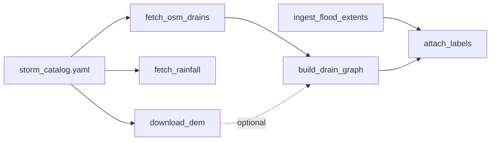

# ML_project — DrainSense (dataset phase)

Thesis work: **drain-graph GNN + physics residual** for urban/drain flooding in the **Vijayawada–Budameru** corridor (Andhra Pradesh).

This repository currently contains the **dataset-only** pipeline:

- Study bbox, storm catalog (Sep 2024 Budameru event first)
- OSM waterway fetch, Open-Meteo rainfall, DEM helpers
- Observed flood-extent ingest stubs (NRSC / Sentinel-1 / IFI)
- Drain-graph build + label attachment (no synthetic SCS-CN labels)

GNN training is intentionally not implemented yet.

## Quickstart

```bash
git clone https://github.com/applejuice093/ML_project.git
cd ML_project
python -m venv .venv
source .venv/bin/activate          # Windows: .venv\Scripts\activate
pip install -r requirements-dev.txt

# 1. Inputs that need no API key
python src/dataset/fetch_osm_drains.py
python src/dataset/fetch_rainfall.py --storm-id budameru_2024_sep

# 2. Build the drain graph (DEM elevations are added if a GeoTIFF is in data/raw/dem/)
python src/dataset/build_drain_graph.py --version v1
```

DEM download, flood-extent ingest and label attachment need manual steps; see
**[README_DATASET.md](README_DATASET.md)** for layout, sources, and the full command list,
and **[STATUS.md](STATUS.md)** for what is done vs. blocked.

## Pipeline



## Tests

```bash
pytest
```

Tests run offline (no Overpass / Open-Meteo calls).

## Troubleshooting

- **Missing OSM GeoJSON** when building the graph → run `fetch_osm_drains.py` first.
- **No elevations on nodes** → drop a DEM GeoTIFF into `data/raw/dem/` (see `download_dem.py --document-only`); install optional `rasterio` if needed.
- **Cannot attach labels** → observed flood extents are still manual; see `ingest_flood_extents.py --checklist`. Never use SCS-CN as ground truth.
- **Tests** → `pip install -r requirements-dev.txt && pytest` (offline; no GitHub Actions workflow in this repo yet).

See **[STATUS.md](STATUS.md)** for done vs blocked, and **[docs/DATASET.md](docs/DATASET.md)** for schema + troubleshooting.

## Repository layout

| Path | What it holds |
| --- | --- |
| `src/dataset/` | Pipeline scripts and shared `config.py` |
| `data/storms/storm_catalog.yaml` | Study bbox and storm windows |
| `data/raw/`, `data/interim/`, `data/processed/` | Pipeline inputs and outputs (large rasters/graphs are git-ignored) |
| `docs/` | Dataset principles and pipeline notes |
| `tests/` | Offline pytest suite |
| `NOVELTY.md` | Research contribution, gated on the observed dataset |
